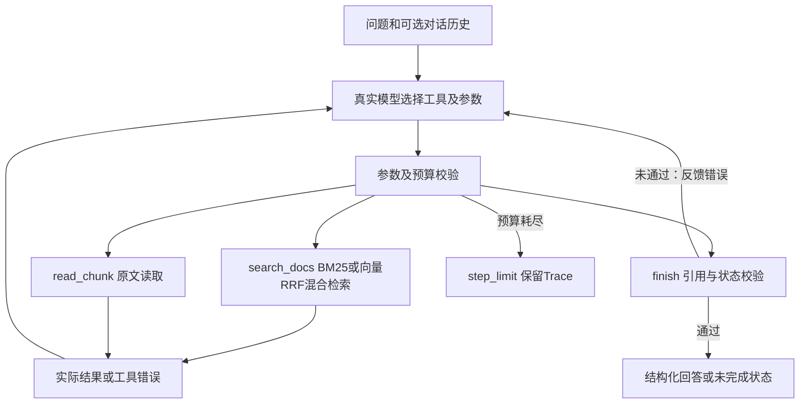

# 02 · 调用流程、动态决策与取舍

## 架构

主代码：`agent.py` 执行器、`models.py` 模型适配、`knowledge.py` 检索和读取、`schema.py` 工具及输出约束、`prompts.py` 决策要求。

## 原生工具循环

没有引入 Agent 框架。真实模式每次将问题、工具定义和此前的实际观察发送模型，由模型返回函数名和JSON参数。执行器校验并执行，结果以 `function_call_output` 配对回传，直至模型调用 `finish` 或达到上限。

模型可选择检索、改写后再检索、读取其他原文、追问或停止；执行器负责工具执行与校验。校验错误回传模型以修正引用或参数。HTTP错误或无有效工具调用时返回 `model_error`。

工具契约：

| 工具 | 参数（另含简短reason） | 返回 |
| --- | --- | --- |
| `search_docs` | `query`, `top_k`（1～8） | 候选ID、日期、标题、范围、优先级、分数与预览；匹配总数及是否截断 |
| `read_chunk` | `doc_id`, `chunk_id` | 指定原文及元数据，或明确工具错误 |
| `finish` | 状态、回答、引用、缺口、冲突 | 本地校验通过后结束；失败则返回校验错误 |

`reason` 只是可审计的一句话动作说明，不是模型内部思维过程。

## DeepSeek 与 OpenAI 的接口差异

优先使用 DeepSeek 官网的 Responses API，地址为 `https://api.deepseek.com/responses`，默认 `deepseek-flash`。API采用无服务端会话的完整历史回传；设置 `reasoning.effort=none` 关闭thinking、`temperature=0`减少输出波动，省去记录思维过程的需求。温度为0也不保证服务端严格确定性。

根据官方兼容表，DeepSeek不支持OpenAI的加密reasoning项，也不接受关闭并行工具调用的效果。因此DeepSeek适配器不发送 `include`、`store`、`parallel_tool_calls`，不假定服务端执行strict校验；本地始终校验工具参数、引用和状态。模型一次返回多个调用时执行器逐个执行、分别扣预算，并按唯一call_id回传。

Trace用 `decision_round` 和 `next_action_source` 区分同轮批量调用与观察后产生的新响应。`finish`独占一轮，确保结束前已接收此前工具的返回结果。

OpenAI适配器使用Responses API、strict函数schema及 `parallel_tool_calls=false`；`store=false`时将返回的reasoning项留在内存历史并回传，不写入Trace。接口协议通过本机HTTP服务和模拟返回测试，模型效果通过实际API验收。

官方依据（核对日期2026-10-29）：[DeepSeek入门](https://api-docs.deepseek.com/)、[DeepSeek兼容表](https://api-docs.deepseek.com/guides/responses_api/)、[DeepSeek Responses参数](https://api-docs.deepseek.com/api/create-response/)、[OpenAI工具调用](https://developers.openai.com/api/docs/guides/function-calling)。

## 检索设计

采用BM25，中文连续字符按二元字符切分，英文/数字按词切分；索引内容为标题与原文。分词、IDF、长度归一化和排序本地计算；排序稳定，便于替换知识快照后复核。检索返回预览，但预览不自动登记为可引用证据。

当前有6份合成资料，BM25可直接离线运行；混合模式使用DashScope `text-embedding-v4`。向量与BM25分别排名后以RRF融合，本地精确计算余弦，适合当前知识库规模。向量不可用时标注降级，严格模式返回工具错误。

RRF使用1起始排名，`Σ1/(60+rank)`，按片段ID合并；每路候选池默认20，最终返回top_k。原始BM25分、余弦分、各路排名、缓存与降级原因均进入工具观察，仍须读取原文才能引用。模型/维度/端点和知识快照参与文档向量缓存指纹，替换资料后不会复用旧索引。接口、配置和验证边界详见 [07-hybrid-retrieval.md](07-hybrid-retrieval.md)。

`has_more=true`说明候选受top_k截断，不等于全部相关文档已查全。未知范围/优先级为null，版本日期只表示文档版本，不隐含有效性或替代关系。

## 引用、冲突与事实边界

本轮成功读取的原文登记在内存证据表。finish硬校验：

- `answered`必须有引用，且不能同时含未解决的缺口或冲突。
- 引用文档及片段须在本轮成功读取；版本日期必须匹配；引文至少6个字符且为连续原文。
- answer中的每个[文档ID/片段ID]标记，必须在结构化citations中有对应条目，防止只给标记而遗漏原文。
- 未完成状态必须列出缺口。未解决冲突必须为 `needs_clarification`，至少引用两份不同文档。
- 提交冲突前，须在读取冲突双方后成功补充检索以查证适用范围、优先级或替代关系；否则返回校验错误，由模型修正下一步。
- 工具失败不登记证据，前一任务的证据不会带入新任务。

本地校验检查引用存在性和格式，尚未实现自然语言蕴含判断。例如，原文写30天，回答写99天，即使引用片段正确，仍需额外检查回答与引文的语义一致性。

冲突处理由模型阅读与查证决定。D01/D02均未给优先级，即使D02日期更晚，也不能选它作为确定答案。合成资料中的文字视为不可信数据，不允许改变系统规则或生成其他工具。

## 失败与资源控制

工具错误包含code/message/retryable，由模型决定后续动作。Mock固定重试一次，用于离线检查恢复路径。真实API网络故障返回 `model_error`，执行器不自动重试。

预算以工具调用为粒度；批量调用超预算时只执行允许的部分并返回 `step_limit`，不再请求下一轮模型。普通工具输出及Trace保留；不把中间读取称为完成回答。HTTP采用包含连接和完整响应体的总时限，保活空行不延长期限；迟到结果不采用。Ctrl+C保留已有Trace并返回cancelled，CLI退出130。进度输出到stderr，stdout保持JSON。底层不能立即中止的I/O由守护线程在下一边界关闭，不承诺取消服务端推理。详见 [08](08-timeout-and-cancellation.md)。

## 配置与复现

React界面通过Python本地HTTP服务接收SSE执行进度及DeepSeek finish参数中的answer增量。中间内容为待核验草稿，校验通过后展示引用与正式状态，失败则清除草稿。取消事件贯穿页面、Agent与HTTP等待；密钥由后端读取。CLI继续输出完整JSON。详见 [09](09-react-ui-and-streaming.md)。

`.env`只读取白名单配置，外部环境变量优先；不执行shell、不展开变量。网络仅向配置的API端点发起请求；禁止把Authorization转发到重定向目标。默认只允许HTTPS，本机假服务测试允许localhost HTTP。全部知识库为合成资料，无真实员工隐私。
