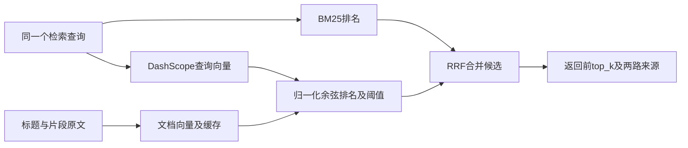

# 07 · DashScope向量检索与BM25/RRF

## 范围与当前证据

按用户要求增加可选混合检索：**BM25 + DashScope `text-embedding-v4` + RRF**。默认仍为BM25，保持无密钥的离线复现入口。全部实现使用Python标准库，无需安装DashScope SDK、NumPy、本地embedding模型或向量数据库。

当前已验证HTTP合同、向量合法性、融合、缓存、降级及严格失败路径。用户计划后续配置向量API，因此**尚未真实调用DashScope，也未验证其召回率、延迟或语义质量提升**。此前及当前 `examples/deepseek/` 的真实模型记录属于BM25基线，不是混合检索效果证据。

## 填写本机配置

现有.env已预留以下字段，不覆盖DeepSeek配置。后续只在本机填入Key：

```dotenv
DASHSCOPE_API_KEY=在本机填写你的Key
DASHSCOPE_EMBEDDING_MODEL=text-embedding-v4
DASHSCOPE_EMBEDDING_DIMENSIONS=1024
DASHSCOPE_EMBEDDING_URL=https://dashscope.aliyuncs.com/api/v1/services/embeddings/text-embedding/text-embedding
DASHSCOPE_TIMEOUT=15
```

用户所称embedding-v4的正式API模型标识为 `text-embedding-v4`，与DeepSeek生成模型是两套独立配置。默认URL为北京兼容域名；如果控制台提供业务空间专属地址，替换为完整原生HTTP端点，例如：

```text
https://你的WorkspaceId.cn-beijing.maas.aliyuncs.com/api/v1/services/embeddings/text-embedding/text-embedding
```

新加坡等其他地域也使用控制台给出的实际URL，**Key与端点地域必须匹配**。URL不应填为OpenAI兼容的 `/embeddings` 地址，因为当前适配器使用DashScope原生请求/响应格式。不得将包含实际Key的.env提交到Git。

接口参考：[原生同步接口、模型标识、维度与批次限制](https://help.aliyun.com/zh/model-studio/text-embedding-synchronous-api)、[阿里云ES文档中的兼容域名配置](https://help.aliyun.com/zh/es/user-guide/configuration-template-big-model-service-platform-refined)。核对日期2026-10-29。默认1024维；文档/查询分别指定 `text_type=document/query`；每批最多10条，API单条Token限制由服务端检查，项目不静默截断原文。

## 运行

```powershell
# 原有BM25模式，无需向量Key
python run.py ask "报销期限多久？" --provider mock

# DeepSeek决策 + DashScope向量 + BM25/RRF
python run.py ask "垫的钱最迟啥时候能报账？" --provider deepseek --retrieval hybrid

# 严格验收：向量不可用时返回工具错误，不允许用BM25替代
python run.py evaluate --provider deepseek --retrieval hybrid --require-vector

# 不联网的融合/降级演示：人工指定向量，不能证明语义召回能力
python scripts/demo_hybrid.py
```

批量混合记录默认保存到 `examples/deepseek-hybrid/`，不会覆盖BM25基线的 `examples/deepseek/`。若选 `--provider mock --retrieval hybrid` 且配置了向量Key，仍会调用真实向量API；生成端Mock与检索端是否联网是独立的。纯离线入口仍是默认BM25或上述demo。

## 排名融合



对片段d：

```text
RRF(d) = Σ [1 / (rrf_k + rank_channel(d))]
```

rank从1开始，只对实际出现的渠道求和，不把未命中项当作第0名。默认 `rrf_k=60`，两路等权；融合按 `(doc_id, chunk_id)` 去重，平分时按ID稳定排序。RRF依据排名，不直接相加不同量纲的BM25与余弦原始分数。[RRF原理说明](https://learn.microsoft.com/en-us/azure/search/hybrid-search-ranking)。

每路先取 `candidate_k=20` 个候选，再融合并截取模型请求的top_k（最多8）。不先按top_k裁剪每路，避免过早丢弃候选。`has_more`与 `candidate_pool_truncated`会标记结果或候选池是否截断；不能据此声称所有相关资料已查全。

向量侧默认余弦阈值0.5，可用 `--vector-min-score`修改；`--candidate-k`和 `--rrf-k`也可配置。**0.5是待校准的工程默认值，不是已经验证的业务最优阈值。** 阈值仅过滤向量渠道，不会删除BM25已经命中的候选。RRF得分和余弦分数都不是答案可信度；资料外查询也可能召回无关片段，模型仍必须判断相关性、读取原文并按证据回答。

## 可观察字段

每个hit保留 `score`、`score_type`、`bm25_score/rank`、`vector_score/rank`。仅由向量召回的片段，其BM25字段为null。

工具返回 `retrieval.requested_mode/used_mode/degraded`，以及融合参数、候选池信息、embedding模型/维度、缓存命中状态、请求ID和Token用量。Key、请求头和完整向量不写入Trace。

## 缓存与文档替换

文档向量延迟到首次检索时构建，在同一KnowledgeBase中复用，并保存到被Git忽略的 `.cache/embeddings/`。指纹包含完整知识快照SHA256、模型、维度、端点和文本拼接方式；文本、日期、模型、端点或维度变化均不会复用旧索引。每次查询单独获取query向量。

缓存使用JSON，读取时验证指纹、数量、维度、有限非零数值；损坏则重建。写入采用临时文件后替换，写缓存失败时保留已获得的内存向量并明确标记。未使用pickle或执行缓存内容。小知识库用精确余弦遍历即可，不需要另启生产向量服务。

## 降级与验证边界

缺Key、网络故障、限流、鉴权失败或无效向量默认降级为BM25，并在观察结果和摘要标注原因。`--require-vector`将其转为 `EMBEDDING_UNAVAILABLE` 工具错误，由模型决定下一步。不会静默调用本地伪向量或把失败当作向量无匹配。

混合批量评估额外检查 `hybrid_not_degraded`，避免仅BM25回答正确就宣称混合检索通过。一次搜索成功使用hybrid不证明质量提升；严格模式失败记录也不会被算成真实向量能力证据。

已保存的4组流程记录位于 [examples/hybrid/](../examples/hybrid/)。前两组是显式标记的人工向量；后两组模拟未配置Key，分别验证降级和严格失败。API合同测试仅调用本机假服务，不是真实DashScope。待填写Key后，应运行真实混合验收，并在独立问题集上比较BM25、向量、RRF的Recall@k/MRR和资料外误召回率；当前不报告未测得的指标。

## 题目是否要求权限、持久对话、UI或部署

| 项目 | 是否必需 | 题目依据 |
| --- | --- | --- |
| 权限系统 | 否 | 未要求账号、角色或文档访问控制；使用合成资料即可 |
| 持久对话服务 | 否 | 输入支持可选历史，不等于必须有数据库或会话服务；现有history JSON已支持上下文验收 |
| UI | 否 | 总要求明确“界面…非必需”，运行方式可选CLI |
| 线上部署 | 否 | 总要求明确“线上部署…非必需”，须有可复制运行步骤 |

依据为仓库 [test.md](../test.md)。GitHub公开可读和代码可复现是交付要求，与线上部署不同。向量检索/RRF同样不是硬性要求，但与题目鼓励的“检索改进”方向一致；是否更好需要实际评估证明。
