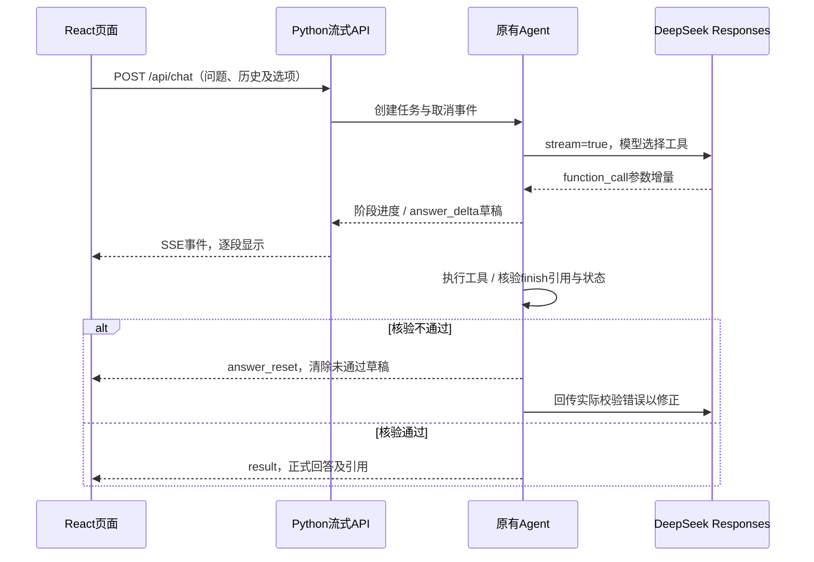

# 09 · React界面与真实流式输出

## 启动

在仓库根目录执行：

```powershell
python run.py serve --build
```

打开 **http://127.0.0.1:8765**。首次构建需要Node.js 22.12+或24及npm。`--build`执行npm ci安装锁定依赖，再运行Vite构建；构建完成后由Python提供页面和API服务。

已有构建时可直接：

```powershell
python run.py serve
# 可选端口与单次模型请求总时限
python run.py serve --port 8765 --timeout 20
```

开发模式可分别运行Python服务和 `frontend/` 中的 `npm run dev`；Vite的5173端口将/api代理到本机8765。CLI原有ask/evaluate命令保持可用，其stdout仍为完整JSON；本次流式交互通过Web API提供。

## 页面功能

- 输入问题、继续追问、新建对话；本次历史保留在页面内存，刷新后清空。
- 切换含冲突的企业资料或单一版本制度；切换知识库时清空旧对话。
- 选择DeepSeek或Mock离线演示，选择BM25或混合检索。
- 显示模型等待、检索、原文读取与核验步骤，支持停止请求。
- 回答完成后显示任务状态、资料缺口、文档版本与逐字原文，支持下载完整运行JSON。
- 桌面三栏布局；手机将设置折叠、原文作为可关闭的侧栏展示。

DeepSeek和DashScope密钥只在Python进程中从本机.env读取，不进入React配置或浏览器。前端无Key输入框，无账号系统、数据库或线上托管。

## 流式链路



模型的原生 `response.function_call_arguments.delta`到达时，从finish工具参数的顶层answer字符串提取新增内容并发送到浏览器。解析处理JSON转义、UTF-8分包、不完整Unicode转义和代理对；页面只展示回答正文。

草稿标为**生成中·待核验**。只有原有finish校验通过后，result才携带正式状态与原文引用。校验失败会发送answer_reset；网络提前断开不会把草稿变成完成答案。离线Mock没有模型Token流，只返回实际进度及最终结果，不模拟逐字生成。

官方格式依据：[DeepSeek Responses流式事件](https://api-docs.deepseek.com/guides/responses_api/)。React与Vite版本以 `frontend/package-lock.json`锁定，核对及开发日期2026-10-30。

## API

| 路径 | 行为 |
| --- | --- |
| GET /api/config | 返回模型/向量是否配置的布尔值与知识库选项；不返回Key |
| POST /api/chat | 返回text/event-stream；请求含question、可选history、provider、retrieval、corpus、request_id |
| POST /api/cancel/{request_id} | 设置取消事件，结束本地模型/工具等待 |

事件包括run_start、progress、answer_start、answer_delta、answer_reset、result与error。底层请求总时限与取消逻辑复用已有实现，UI停止会传播到HTTP等待。取消不保证服务端推理立即停止，也不撤销已经完成的回答。

本地服务限制请求体、历史长度、选项和并发数，使用固定知识库映射，静态文件从构建目录读取。默认监听loopback并检查Origin/Host。当前访问限制适用于本地运行，线上使用还需身份认证与授权。

## 实际验证

- Python：74项测试通过，包含原有63项及11项SSE/服务合同测试。
- 前端事件解析：4项Node测试通过，覆盖UTF-8分包、HTTP错误、事件流校验，以及结束前即可收到增量。
- 浏览器：8项Playwright用例通过，覆盖桌面/手机、正常回答、冲突、上下文、引用查看/下载、草稿先出现、停止、校验重置和提前断开。部分浏览器场景使用明确标记的受控HTTP分片，只验证页面状态，不代表真实模型质量。
- 真实API：DeepSeek + DashScope混合检索的一次流式运行收到182个回答增量，首段约9.4秒、约11.2秒完成；拼接文本与最终校验答案一致，保存在 [live-stream.json](../examples/ui/live-stream.json)。这是一条实际运行记录，不是平均延迟指标。
- 真实浏览器：Microsoft Edge中先观察到草稿，再获得needs_clarification和两条引用，无页面脚本错误，见 [live-browser.json](../examples/ui/live-browser.json)。

构建/测试原始记录：[frontend-checks.json](../examples/ui/frontend-checks.json)、[browser-tests.json](../examples/ui/browser-tests.json)。布局截图：[桌面](../examples/ui/desktop.png)、[手机](../examples/ui/mobile.png)、[真实流式草稿](../examples/ui/live-streaming.png)、[真实回答及原文](../examples/ui/live-answer.png)。截图仅补充布局验证，不替代代码和运行记录。

首次浏览器验证6/7通过，手机设置抽屉没有独立关闭按钮，遮罩阻挡了继续提问。已保留 [修正前截图](../examples/ui/development/mobile-settings-before-fix.png)，补上明确关闭按钮后复测通过，随后加入第8项提前断开检查。

复现检查：

```powershell
python scripts/check.py
cd frontend
npm ci
npm test
npm run build
npm run test:e2e
```

Windows测试使用已安装的Edge；Linux/CI先执行 `npx playwright install --with-deps chromium`。浏览器测试无需模型Key，实际API流式记录单独保存。当前验证覆盖本地功能与小规模合成资料，检索质量、生产并发和提示注入防护待进一步评估。
